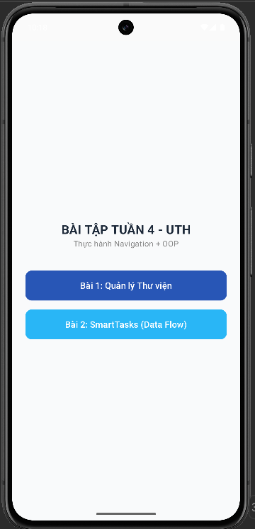
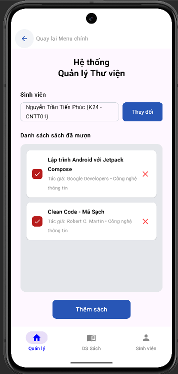
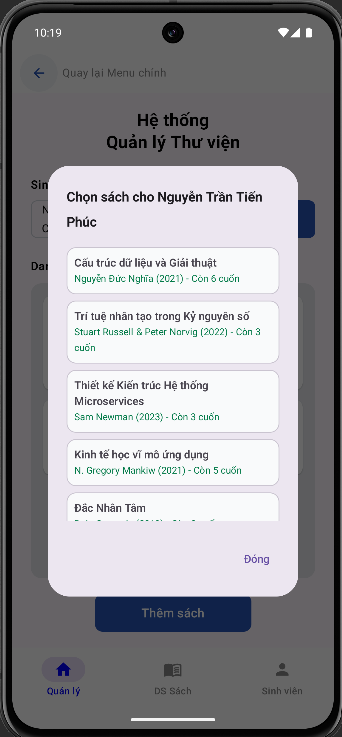
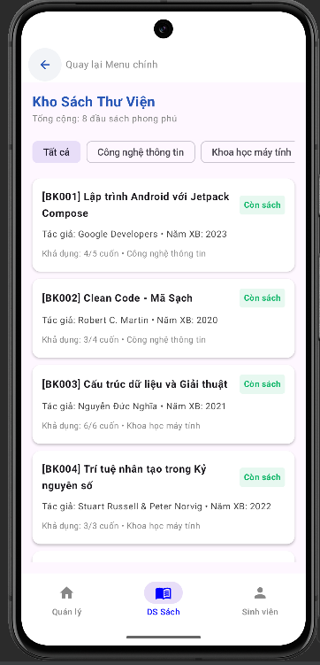
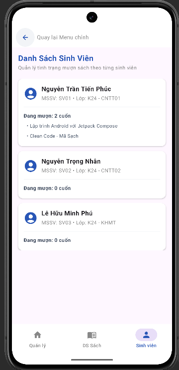
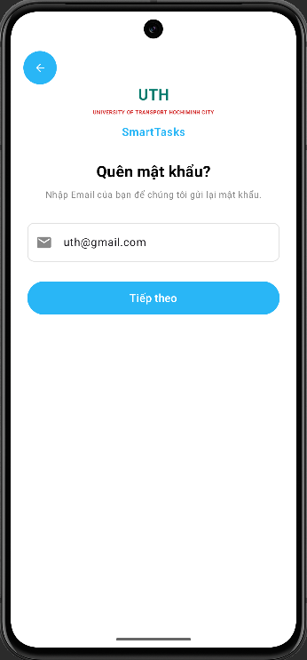
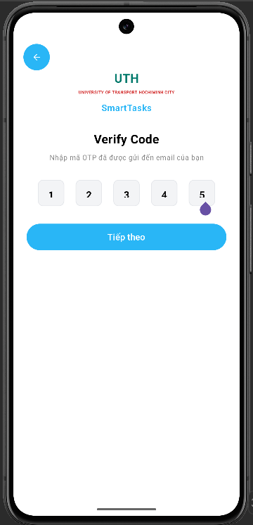
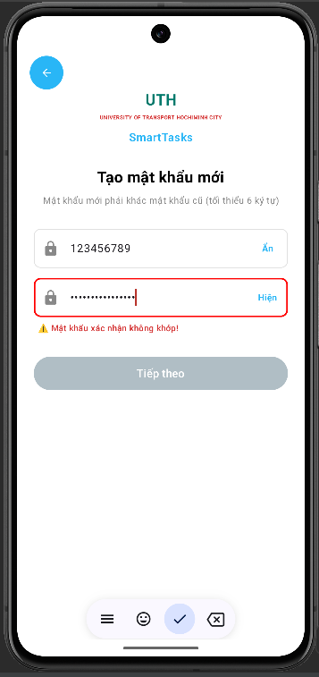
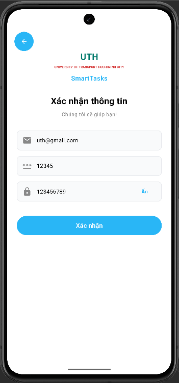

# BÁO CÁO BÀI TẬP TUẦN 4
## Chủ đề: Thực hành Navigation (Điều hướng dữ liệu) & Lập trình Hướng đối tượng (OOP)  
## Nền tảng: Android Jetpack Compose | Kotlin  

---

## MENU CHÍNH (MAIN APP SWITCHER)
- Ứng dụng tích hợp cả 2 bài tập vào một dự án duy nhất (`BTVN_Tuan41`) với kiến trúc phân gói **Package-by-Feature** (`thuvien` và `smarttasks`).
- Màn hình khởi động cho phép lựa chọn linh hoạt giữa **Bài 1** và **Bài 2**.
- Cả 2 bài đều hỗ trợ thanh điều hướng và nút **Quay lại Menu chính** (được tối ưu tự động đẩy xuống dưới thanh trạng thái và lỗ camera bằng `statusBarsPadding()`).

---

## 📚 PHẦN 1: HỆ THỐNG QUẢN LÝ THƯ VIỆN (BÀI 1)

### 1. Mô tả bài tập & Mục tiêu đạt được
- **Mô tả:** Xây dựng ứng dụng quản lý thư viện mô phỏng nghiệp vụ mượn và trả sách giữa Sinh viên và Kho sách trường UTH.
- **Mục tiêu đạt được:**
  - Áp dụng triệt để các nguyên lý **Lập trình Hướng đối tượng (OOP)**:
    - **Tính bao đóng (Encapsulation):** Toàn bộ nghiệp vụ kiểm tra tồn kho, trừ/cộng sách (`borrowOne()`, `returnOne()`) được đóng gói bên trong lớp `Book`.
    - **Repository Pattern:** Phân tách hoàn toàn dữ liệu tại `LibraryRepository`, tách biệt logic nghiệp vụ khỏi giao diện Jetpack Compose.
    - **Mô hình hóa dữ liệu (Domain Modeling):** Sử dụng các Data Class `Book`, `Student` và Enum `BookCategory`.
  - **Kho dữ liệu thực tế & phong phú:** Cung cấp đa dạng đầu sách chuyên ngành (Lập trình Android, Clean Code, Cấu trúc dữ liệu, Trí tuệ nhân tạo, Microservices, Kinh tế, Kỹ năng mềm...) thay vì các tên sách mẫu đơn điệu.
  - **Bottom Navigation Bar:** Điều hướng mượt mà giữa 3 tab nghiệp vụ: **Quản lý**, **DS Sách** và **Sinh viên**.

### 2. Giải thích ngắn gọn các lớp & hàm chính
- **`Book` & `BookCategory` (`thuvien/model/`):**
  - Chứa thuộc tính: `id`, `title`, `author`, `category`, `publishYear`, `totalCopies`, `borrowedCopies`.
  - Thuộc tính dẫn xuất: `availableCopies` (số lượng còn lại = tổng - đã mượn), `isAvailable` (còn sách để mượn hay không).
  - Hàm `borrowOne()` & `returnOne()`: Đảm bảo số lượng sách trong kho luôn được cập nhật an toàn.
- **`Student` (`thuvien/model/`):**
  - Quản lý thông tin sinh viên (`id`, `name`, `className`) và danh sách mã sách đang mượn (`borrowedBookIds`).
  - Hàm `borrow(bookId)` & `returnBook(bookId)`: Cập nhật danh sách sách sinh viên mượn/trả.
- **`LibraryRepository` (`thuvien/repository/`):**
  - `getAllBooks()`: Lấy danh sách toàn bộ kho sách.
  - `getAllStudents()` / `getStudentById(id)`: Truy vấn thông tin sinh viên.
  - `getBooksByStudent(studentId)`: Lấy chi tiết các cuốn sách mà sinh viên cụ thể đang mượn.
  - `borrowBook(studentId, bookId)`: Thực hiện mượn sách nếu sách còn trong kho và sinh viên chưa mượn cuốn đó.
  - `returnBook(studentId, bookId)`: Xử lý trả sách, phục hồi số lượng tồn kho.
- **`LibraryMainScreen` (`thuvien/ui/`):**
  - Quản lý trạng thái chuyển đổi giữa 3 tab giao diện.
  - Tích hợp nút Back quay lại Menu chính và thanh Bottom Navigation chuẩn Material 3.

### 3. Kết quả đầu ra của ứng dụng (Output - Bài 1)
| 1. Màn hình Menu chọn bài tập | 2. Tab Quản lý mượn/trả sách |
| :---: | :---: |
|  |  |
| 3. Hộp thoại Thêm sách từ kho | 4. Tab Danh mục sách phong phú |
| :---: | :---: |
|  |  |
| 5. Tab Quản lý danh sách sinh viên 
| :---: | 
|  | 
---

## 🔐 PHẦN 2: SMARTTASKS - NAV DATA FLOW (BÀI 2)

### 1. Mô tả bài tập & Mục tiêu đạt được
- **Mô tả:** Xây dựng luồng khôi phục mật khẩu gồm 4 màn hình liên tiếp, thu thập và truyền dữ liệu liên tục: **Email $\rightarrow$ OTP $\rightarrow$ Tạo mật khẩu mới $\rightarrow$ Xác nhận thông tin (Confirm)**.
- **Mục tiêu đạt được:**
  - Nắm vững kỹ thuật điều hướng bằng **Jetpack Navigation Component (`NavHost`, `NavController`)**.
  - Truyền dữ liệu an toàn xuyên suốt 4 màn hình (**Data Flow**) thông qua đối tượng OOP `PasswordState`.
  - **Kiểm tra tính hợp lệ & trùng khớp mật khẩu (Password Matching Validation):** Báo lỗi tức thì khi mật khẩu xác nhận không khớp và khóa nút *Tiếp theo* cho đến khi hợp lệ.
  - **Tính năng Hiện/Ẩn mật khẩu (Show/Hide Password):** Cho phép người dùng chuyển đổi hiển thị văn bản thực để tránh gõ nhầm ở cả bước tạo và bước xác nhận.

### 2. Giải thích ngắn gọn các lớp & hàm chính
- **`PasswordState` (`smarttasks/model/`):**
  - Đóng gói 3 trường dữ liệu: `email`, `otpCode`, `newPassword` để lưu giữ trạng thái trong suốt hành trình.
- **`SmartTasksNav` (`smarttasks/ui/`):**
  - Quản lý `NavHost` điều phối 4 chặng:
    1. Chặng 1 (`email_step`): Nhập Email $\rightarrow$ Lưu `state.email` $\rightarrow$ Chuyển sang OTP.
    2. Chặng 2 (`otp_step`): Nhập 5 ô OTP $\rightarrow$ Ghép chuỗi lưu `state.otpCode` $\rightarrow$ Chuyển sang Đặt mật khẩu.
    3. Chặng 3 (`pass_step`): Nhập mật khẩu & xác nhận $\rightarrow$ Kiểm tra khớp $\rightarrow$ Lưu `state.newPassword` $\rightarrow$ Chuyển sang Xác nhận.
    4. Chặng 4 (`confirm_step`): Hiển thị đồng thời cả 3 giá trị đã thu thập được từ các bước trước.
- **`ResetPasswordScreen` (`smarttasks/ui/`):**
  - State `passwordVisible` & `confirmPasswordVisible`: Điều khiển chế độ `VisualTransformation.None` (Hiện) hoặc `PasswordVisualTransformation()` (Ẩn).
  - Validation logic: `passwordsMatch = (password == confirmPassword)`. Nếu sai, hiển thị viền đỏ và dòng thông báo lỗi; nếu đúng, hiển thị thông báo xanh và mở khóa nút *Tiếp theo*.
- **`ConfirmScreen` (`smarttasks/ui/`):**
  - Hiển thị đầy đủ Email, OTP và Mật khẩu (mặc định ẩn dạng `••••••••` và có nút *Hiện* để kiểm tra lại trước khi bấm xác nhận).

### 3. Kết quả đầu ra của ứng dụng (Output - Bài 2)
| 1. Màn hình 1: Nhập Email | 2. Màn hình 2: Nhập mã OTP |
| :---: | :---: |
|  |  |
| 3. Màn hình 3: Tạo mật khẩu & Kiểm tra khớp | 4. Màn hình 4: Xác nhận đầy đủ thông tin |
| :---: | :---: |
|  |  |
---
